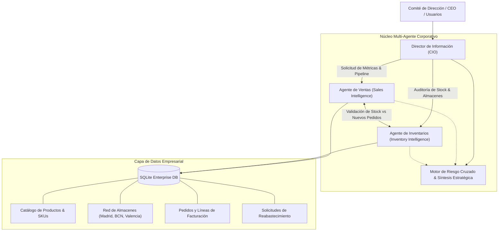

# Sistema Corporativo Multi-Agente: CTIN (CIO, Ventas e Inventarios)

Sistema empresarial multi-agente diseñado para coordinar, auditar y cruzar los flujos de información comercial y de cadena de suministro de **CTIN**, bajo la dirección estratégica del **Chief Information Officer (CIO) / Director de Información**.

* **Empresa:** CTIN
* **Moneda:** Dólares Americanos ($ USD)
* **Fuente de Datos:** Extracciones ODBC (`ctin_produccion`)
* **Catálogo:** 24,522 SKUs y 34 Almacenes / Plantas


---

## 🏛️ Arquitectura del Sistema



---

## 🤖 Roles y Agentes

### 1. Director de Información (CIO / Chief Information Officer)
- **Rol**: Orquestador principal y estratega de TI y negocio.
- **Responsabilidades**:
  - Unificar la visión de los silos de datos (Ventas vs. Operaciones).
  - Detectar **riesgos cruzados**: cuando un producto estrella de ventas tiene stock insuficiente o en nivel crítico.
  - Evaluar la viabilidad de nuevos contratos y ventas de gran escala (`simulate_deal_feasibility`).
  - Generar **Informes Ejecutivos Integrales** (`ExecutiveBriefing`) para el comité directivo.

### 2. Agente Gestor de Ventas (`SalesAgent`)
- **Rol**: Especialista en métricas comerciales y clientes.
- **Herramientas**:
  - `get_sales_kpis()`: Facturación total, ticket promedio, pedidos completados y pendientes.
  - `get_top_selling_products()`: Ranking de productos por ingresos y unidades vendidas.
  - `get_sales_by_region()` y `get_sales_by_category()`: Desglose territorial y por línea de producto.
  - `get_sales_pipeline_insights()`: Diagnóstico del pipeline de ingresos comprometidos.

### 3. Agente Gestor de Inventarios (`InventoryAgent`)
- **Rol**: Especialista en almacenes, logística y disponibilidad física.
- **Herramientas**:
  - `get_inventory_kpis()`: Valoración de stock a coste y venta, ocupación de almacenes.
  - `get_critical_stock_alerts()`: Detección proactiva de SKUs bajo el stock de seguridad o punto de reorden.
  - `get_stock_by_sku(sku)`: Ficha detallada de stock disponible, reservado y lead time por almacén.
  - `create_restock_request(sku, quantity, urgency)`: Generación de órdenes de compra automáticas.
  - `check_stock_availability(items)`: Validación de stock disponible antes de comprometer ventas.

---

## 🚀 Uso Rápido y Comandos

El proyecto incluye un ejecutable CLI y un servicio API REST con FastAPI.

### 1. Generar Informe Ejecutivo del CIO
Genera un análisis completo con KPIs, riesgos cruzados y acciones estratégicas:
```bash
PYTHONPATH=src python3 src/enterprise_agents/cli.py --report
```

### 2. Simular Viabilidad de Negocios y Ventas
El CIO evalúa si la empresa cuenta con el stock necesario para abastecer pedidos de gran envergadura:
```bash
PYTHONPATH=src python3 src/enterprise_agents/cli.py --simulate
```

### 3. Modo Interactivo de Diálogo (CLI)
Interactúa de forma conversacional con el CIO en tiempo real:
```bash
PYTHONPATH=src python3 src/enterprise_agents/cli.py --interactive
```

### 4. Iniciar API REST
Exponer los agentes a través de endpoints HTTP para aplicaciones web o integraciones ERP:
```bash
PYTHONPATH=src python3 src/enterprise_agents/cli.py --serve --port 8000
```
Endpoints principales:
- `GET /api/cio/executive-report`: Informe consolidado en formato JSON.
- `POST /api/cio/chat`: Consulta directa al CIO.
- `POST /api/sales/chat`: Consulta al Gestor de Ventas.
- `POST /api/inventory/chat`: Consulta al Gestor de Inventarios.
- `POST /api/simulate-deal`: Evaluación de viabilidad de pedidos.

### 5. Ejecutar Pruebas Automatizadas
```bash
PYTHONPATH=src python3 -m unittest discover -s tests
```

---

## 🌐 Subagentes Configurados en el Entorno AI

Además del software en Python, se han registrado los siguientes subagentes nativos en este entorno:
- `cio_agent`: Puede invocarse para coordinar tareas entre ventas e inventario durante tus sesiones.
- `sales_agent`: Especializado en métricas comerciales.
- `inventory_agent`: Especializado en auditoría de existencias y almacenes.
